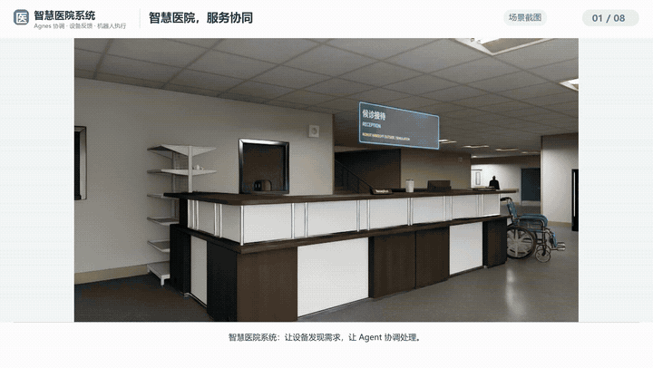
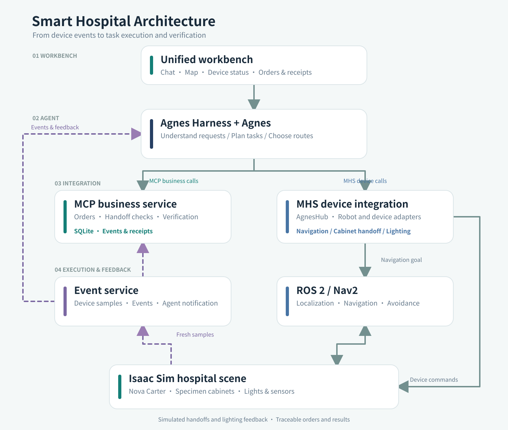

# Smart Hospital System

English | [简体中文](README.zh-CN.md)

Smart Hospital System is a simulated hospital ward where Agnes coordinates specimen delivery and room lighting in response to device events.

> Research prototype in simulation. Specimen handling is a scripted simulated handoff, and the lighting sensor reports a modelled relative index, not lux. This is not a clinical system and has not been validated on physical robots or in a real hospital.

## Project overview

Ward staff handle recurring tasks such as specimen delivery and room checks. This project brings those tasks into one workbench: devices report a need, and Agnes arranges the response.

- **Specimen delivery:** B and C pickup cabinets report sealed specimens. One Nova Carter robot, with two cargo slots, picks them up and delivers them to a laboratory reception cabinet.
- **Lighting feedback:** simulated sensors in rooms 301 and 303 detect persistently low relative illumination. The agent can command the corresponding light and check fresh feedback.
- **Task and route coordination:** Agnes decomposes service needs and selects from candidate routes using information such as path length, estimated time and exposure to people. Nav2 handles navigation and obstacle avoidance.
- **Unified workbench:** a single page presents chat, the agent's plan, device status, the map, robot position, cargo, receipts and first- and third-person simulation views.
- **Auditable execution:** order identity, capacity, destination, operation IDs, scene acknowledgements, fresh samples and confirmed stops are checked by the business and device layers.

Agnes decides the order of work. A delivery or lighting issue is closed only after device feedback confirms the result. Orders, device status and receipts are visible in the workbench.

## Demo video

[](https://www.bilibili.com/video/BV1Rvxc6tEwS/)

[Watch the extended demo on Bilibili](https://www.bilibili.com/video/BV1Rvxc6tEwS/) (4 min 58 sec; Chinese narration).

[Download the media collection from Baidu Netdisk](https://pan.baidu.com/c/1rQSv6LUlh6DtN8o9eGTgRQ?pwd=xxxp) — extraction code: `xxxp`. Includes the preview GIF, full-length GIF, compressed narrated MP4 and 1080p extended demo.

Lightweight repository video:

[Quick access: watch or download the compressed demo](docs/media/smart-hospital-demo-zh.mp4) (8.76 MB; 4 min 58 sec; 540p; Chinese narration retained). It shows the workbench, specimen delivery and lighting feedback. The video combines labelled clips from different runs.

## Architecture



Isaac Sim runs the hospital scene. The event service detects device needs and notifies Agnes. Agnes uses MCP for business operations and MHS for device commands; Nav2 controls the robot. Project services keep orders, receipts and device feedback.

## Integration standards

| Interface | Use in this project |
| --- | --- |
| [Model Context Protocol (MCP)](https://modelcontextprotocol.io/) | Project business server over stdio. The smart-ward catalog includes `get_state`, `get_route_options`, `create_specimen_delivery`, `publish_service_plan`, `defer_order`, `close_order`, `verify_services` and `wait_event`. |
| [Agnes MHS](https://github.com/AgnesAI-Labs/agnes-harness/blob/57d0c34b33527294042b7ab8a60d7c7c934e932e/docs/guide/mhs.md) | Device integration via AgnesHub: one robot, three cabinets, two lights and two read-only sensors. The agent reads/watches devices and invokes device commands, including `navigate_route`, `handoff_order` and `set_brightness`. |
| ROS 2 Humble and Nav2 | Robot localization, navigation actions and motion control in the simulated hospital. |
| Isaac Sim 6.0.1 | Hospital scene, robot, simulated devices, scene feedback and camera views. |
| Project HTTP/JSON and SQLite | Local workbench and business state, operation/receipt records and event persistence. Services bind to loopback by default. |

The project pins Agnes Harness/MHS to upstream commit `57d0c34b33527294042b7ab8a60d7c7c934e932e`. Device registration and the eight-tool catalog do **not** by themselves establish full MHS conformance. The model does not directly generate velocity commands; route execution remains with Nav2.

## Environment and running

Use Ubuntu 22.04, a compatible NVIDIA GPU and driver, a legally installed Isaac Sim 6.0.1 and its required official assets, Docker, Python 3.10, Node.js 24.14.0 and pnpm 10.34.5. A real agent run requires your own valid Agnes provider credentials. The simulator, official runtime assets and account credentials are not included in this repository.

Clone the repository on your own Linux host. Use a short directory to avoid Unix socket path limits, then follow the [deployment guide](docs/DEPLOYMENT.en.md) to build the runtime, obtain assets and install plugins. Replace `ISAAC_HOME` with your own installation path:

```bash
git clone https://github.com/Neptune0810/smart-hospital-system-.git "$HOME/smart-hospital"
cd "$HOME/smart-hospital"
export PROJECT_ROOT="$PWD"
export ISAAC_HOME="/path/to/your/isaac-sim-6.0.1"
python3 portable/control.py init
# Review portable/config.json, then prepare this instance.
python3 portable/control.py prepare
# Build the runtime and navigation image; acquire assets and install plugins
# using the commands in docs/DEPLOYMENT.en.md.
python3 portable/control.py doctor
python3 portable/control.py start
python3 portable/control.py status
```

Open `http://127.0.0.1:4294/` on the machine running the project. For a remote server, use the SSH forwarding template in the guide with your own connection details. Configure your Agnes account in Provider settings. Ports, GPU index and ROS domain can be changed before preparation. Run `python3 portable/control.py stop` to stop the instance.

## Verification and limitations

| Run | Observed result | Scope |
| --- | --- | --- |
| 2026-10-14 independent reproduction | Build, simulated scene and eight fresh devices passed. A bounded depot navigation attempt timed out; the later checks and real Agent run were not executed. | Preserved in [VERIFICATION.json](VERIFICATION.json). The failure is not overwritten by the later run. |
| 2026-10-28–29 normal smart-ward run | Real Agnes handled a B-cabinet specimen and a room-301 lighting event. Both navigation legs succeeded, the laboratory cabinet issued a matching simulated receipt, and `verify_services` returned two resolved needs and no pending needs. | One separately prepared short-path instance on the same GPU server; approximately 34 minutes to final verification. Not a different-machine reproduction or an exhaustive benchmark. |

During the later run, the first light-control attempt was denied because the model chose an unsupported interface; it subsequently used the correct device command. The laboratory navigation encountered no-progress recoveries before arriving. The robot ended stopped at the laboratory, not back at the depot. Urgent insertion, failure recovery, the full MHS conformance suite and physical deployment were not revalidated in that run. The recorded lighting event states that three fresh samples met the recovery condition, but its retained event record contains only the last sample and the conclusion.

## Repository and third-party materials

- `mhs/`: smart-ward business service, device adapters, event handling and workbench.
- `portable/`: project-scoped configuration and lifecycle commands.
- `reproduction/`: pinned build inputs, asset acquisition and validation tools.
- `configs/`, `maps/`: simulation and navigation configuration.
- `vendor/` and `third-party/`: pinned Agnes Harness source bundle and upstream notices.

See [THIRD_PARTY.md](THIRD_PARTY.md) for component origins and licenses. The Apache-2.0 license included under `third-party/agnes-harness/` applies to that upstream component; the project team's own license has not yet been specified. NVIDIA software and assets must be obtained and used under their own terms.

The real-agent run above used `agnes-3.0-flash`. 
