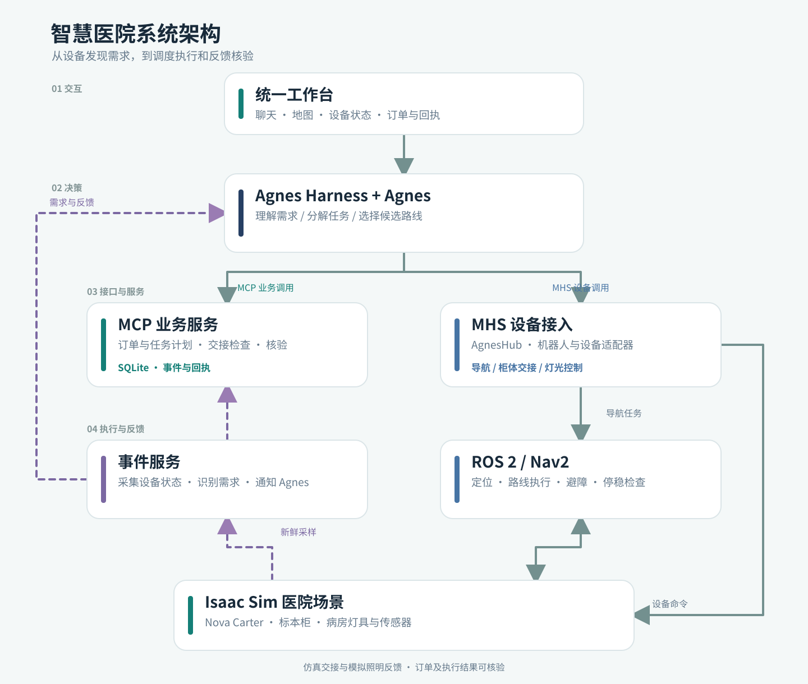

# 智慧医院系统

[English](README.md) | 简体中文

智慧医院系统是一个医院场景仿真项目。Agnes 根据标本柜和病房照明的反馈安排任务，由移动机器人送检，并检查交接和照明恢复结果。

> 本项目是仿真研究原型。标本交接通过程序模拟，照明传感器报告的是仿真模型的相对指数，不是勒克斯（lux）。项目尚未在真实机器人或医院中验证，不能作为临床系统使用。

## 项目介绍

病区中有不少需要反复处理的事务，例如取送标本、检查病房照明。这个项目把这些事务放在同一套工作台中，由设备发现需求，Agent 安排处理。

- **标本取送**：B、C 护士站取件柜报告待取封装标本；一台具有两个载货位的 Nova Carter 机器人取件并送至检验接收柜。
- **照明反馈**：301、303 病房的仿真传感器检测持续照明不足；Agent 可调节对应灯具并检查新反馈。
- **任务分解与路线选择**：Agnes 分解需求，并根据路径长度、预计时间、人群暴露等信息从候选路线中选择；Nav2 负责实际导航与避障。
- **统一工作台**：同一页面展示聊天、Agent 安排、设备状态、地图、机器人位置、载货、回执及第一、第三人称仿真画面。
- **可核验执行**：业务和设备层检查订单身份、容量、地点、操作编号、场景确认、新鲜采样和真实停稳状态。

设备发现需求后，Agent 决定处理顺序；交接和照明恢复都需要设备反馈确认。订单、设备状态和处理结果可以在工作台查看。

## 视频介绍

[观看或下载演示视频](docs/media/smart-hospital-demo-zh.mp4)（4 分 18 秒，中文讲解）。视频展示工作台、标本取送和照明反馈，由标注过的不同运行片段剪辑而成。

## 架构介绍



Isaac Sim 运行医院场景，事件服务发现设备需求并通知 Agnes。Agnes 通过 MCP 操作业务，通过 MHS 控制设备；Nav2 负责机器人运动。订单、交接回执和设备反馈由项目服务保存。

## 集成标准

| 接口或技术 | 项目中的用途 |
| --- | --- |
| [Model Context Protocol（MCP）](https://modelcontextprotocol.io/) | 业务服务通过 stdio 接入。智慧病区工具包括 `get_state`、`get_route_options`、`create_specimen_delivery`、`publish_service_plan`、`defer_order`、`close_order`、`verify_services` 和 `wait_event`。 |
| [Agnes MHS](https://github.com/AgnesAI-Labs/agnes-harness/blob/57d0c34b33527294042b7ab8a60d7c7c934e932e/docs/guide/mhs.md) | 通过 AgnesHub 接入一台机器人、三个柜体、两个灯具和两个只读传感器。Agent 读取、监听设备，并调用 `navigate_route`、`handoff_order`、`set_brightness` 等设备命令。 |
| ROS 2 Humble 与 Nav2 | 提供仿真医院中的定位、导航动作和运动控制。 |
| Isaac Sim 6.0.1 | 提供医院场景、机器人、仿真设备、场景反馈和相机画面。 |
| 项目 HTTP/JSON 与 SQLite | 提供本地工作台、业务状态、操作与回执记录以及事件持久化；服务默认监听回环地址。 |

项目将 Agnes Harness/MHS 固定于上游提交 `57d0c34b33527294042b7ab8a60d7c7c934e932e`。设备注册和八项工具目录通过并不等于完整 MHS 协议认证。模型不直接生成速度控制命令，路线执行由 Nav2 负责。

## 环境配置与运行

需要 Ubuntu 22.04、兼容的 NVIDIA GPU 与驱动、合法安装的 Isaac Sim 6.0.1 和所需官方资产、Docker、Python 3.10、Node.js 24.14.0、pnpm 10.34.5。真实 Agent 运行还需要使用者自己的有效 Agnes 账号。仿真器、官方运行资产及账号凭据不随本仓库提供。

在自己的 Linux 主机上克隆仓库，目录尽量短，以免 Unix socket 路径过长。按[部署指南](docs/DEPLOYMENT.md)完成构建、资产准备和插件安装。下面是入口命令；运行前请将 `ISAAC_HOME` 改为自己的安装路径：

```bash
git clone https://github.com/Neptune0810/smart-hospital-system-.git "$HOME/smart-hospital"
cd "$HOME/smart-hospital"
export PROJECT_ROOT="$PWD"
export ISAAC_HOME="/path/to/your/isaac-sim-6.0.1"
python3 portable/control.py init
# 检查 portable/config.json，然后为当前实例生成配置。
python3 portable/control.py prepare
# 按 docs/DEPLOYMENT.md 构建运行环境和导航镜像、准备资产并安装插件。
python3 portable/control.py doctor
python3 portable/control.py start
python3 portable/control.py status
```

在运行项目的机器上打开 `http://127.0.0.1:4294/`。如果项目运行在远程服务器，可按指南用自己的 SSH 信息转发端口，再在自己的电脑打开网页。在 Provider 设置页配置自己的 Agnes 账号；端口、GPU 和 ROS domain 可在 prepare 前调整。停止服务使用 `python3 portable/control.py stop`。

## 验证结果与范围

| 测试 | 结果 | 范围 |
| --- | --- | --- |
| 2026-10-14 独立复现 | 构建、仿真场景和八设备新鲜反馈通过；有限导航中到物资库超时，后续检查和真实 Agent 测试未执行。 | 原结果保留在 [VERIFICATION.json](VERIFICATION.json)，不被后来的运行覆盖。 |
| 2026-10-28 至 29 日智慧病区正常流程 | 真实 Agnes 处理 B 站标本和 301 照明事件；两段导航成功，检验柜产生匹配的仿真回执，`verify_services` 返回两项已解决、无待处理项。 | 同一 GPU 服务器上的独立短路径副本，最终核验约用 34 分钟；不是跨机器复现或完整基准测试。 |

后一次运行中，模型首次选择了不支持的调灯接口，随后改用正确设备命令；送检导航出现无进展恢复后到达。机器人最终停在检验交接点，没有返回物资库。本轮未重新验证急件插单、异常恢复、完整 MHS 协议测试集或实体部署。照明事件记录写明连续三次新鲜读数满足恢复条件，但留存事件仅包含最后一个读数和结论。

## 目录与第三方材料

- `mhs/`：智慧病区业务服务、设备适配、事件处理和工作台。
- `portable/`：项目专用配置与启动、状态、停止入口。
- `reproduction/`：固定构建输入、资产取得和验证工具。
- `configs/`、`maps/`：仿真和导航配置。
- `vendor/`、`third-party/`：固定 Agnes Harness 源码 bundle 和上游许可说明。

第三方来源与授权见 [THIRD_PARTY.md](THIRD_PARTY.md)。`third-party/agnes-harness/` 中的 Apache-2.0 许可适用于该上游组件；团队自有代码的许可证尚未确定。NVIDIA 软件与资产需按其各自条款取得和使用。

上述真实 Agent 测试使用 `agnes-3.0-flash`。开发和文档整理使用了 Codex 辅助。
